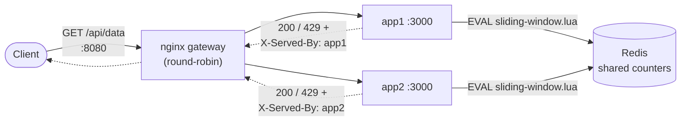

# Rate Limiter / API Gateway

An API gateway that protects a backend service from being overwhelmed by any single client, by capping how many requests each client can make in a rolling time window — the same basic mechanism that keeps a public API standing under abusive traffic, whether that's a scraper hammering an endpoint, a client stuck in a retry loop, or a deliberate denial-of-service attempt. Real APIs (GitHub, Stripe, Cloudflare) all rate limit for exactly this reason.

The limiting logic here is hand-written rather than pulled from a library like `express-rate-limit`, on purpose: the point of this project was to understand, and be able to explain, how a rate limiter behaves under the constraints that actually matter in production — what happens at the boundary of a fixed time window, what happens when two servers are limiting the same client independently, and what happens when the datastore holding the rate-limit state goes down mid-request. Each of those failure modes is implemented, deliberately shown to break in one version, then fixed in the next.

## Architecture

Running behind Docker Compose, nginx load-balances across two independent app instances that share one Redis-backed rate limit store:



Every request — regardless of which instance nginx routes it to — checks and updates the *same* Redis key for that client IP. That's what makes the limit hold at "10 total," not "10 per instance." (See [Solving the Distributed Race Condition](#solving-the-distributed-race-condition) for why sharing storage alone isn't enough.)

Inside a single instance, the request pipeline is:

```
client ──▶ [ request logger ] ──▶ [ rate limiter ] ──┬──▶ /api/data ──▶ 200 + JSON
                                                      │
                                                      └──▶ over limit ──▶ 429 + Retry-After
```

`/health` is mounted outside the rate limiter, deliberately — a health check that gets rate limited would pull a healthy instance out of the load balancer's rotation for no reason.

## Algorithms Implemented

Three interchangeable rate-limiting strategies live side by side in `src/middleware/`, selected at runtime by an environment variable, so the tradeoffs between them can be demonstrated rather than just described:

| Strategy | File | State | Shared across instances | Tradeoff |
|---|---|---|:---:|---|
| Fixed window | `fixedWindow.js` | in-memory `Map` | No | Cheapest (one counter + one timestamp per client), but has the boundary-burst flaw below. Kept only for comparison. |
| Sliding window log | `slidingWindow.js` | in-memory `Map` of timestamp arrays | No | Exact — no boundary flaw — but correct only on a single instance; each process keeps its own separate counters. |
| Sliding window log (Redis) | `slidingWindowRedis.js` | Redis sorted set | **Yes** | Exact *and* shared fleet-wide, atomic under concurrency, self-expiring. Costs a network round trip and a dependency on Redis being reachable. |

**The fixed-window flaw, concretely:** a fixed window resets its counter to zero at clock-aligned boundaries (e.g. the top of every minute). A client can send `max` requests in the last instant of one window and another `max` in the first instant of the next — both batches are individually under the limit, since the counter legitimately reset in between, but the two batches land within a fraction of a second of each other on the wall clock. With `max=10`: 10 requests at `10:00:59.9` plus 10 more at `10:01:00.1` is 20 requests inside a 200ms span, and a fixed window allows every one of them. A sliding window log has no shared reset boundary to exploit — every request's window is measured backwards from that request's own timestamp — so this burst is impossible by construction.

**Sliding log vs. the theoretical "sliding window counter":** a sliding log stores every timestamp, so it's exact. A weighted sliding-window *counter* (not implemented here) would store just two integers per client and approximate the count by blending the previous window's rate — cheaper per client, but capable of being slightly wrong near the window edge. At 10 requests/minute, a handful of timestamps per client costs nothing, so exactness was the easy choice; the counter becomes the right tradeoff only at much higher limits where per-client memory actually matters.

## Solving the Distributed Race Condition

Sharing Redis as storage is necessary but not sufficient. The obvious translation of the in-memory logic — read the count, compare to the limit, write if allowed — is still a race once more than one process touches the same key:

```
instance A: GET count -> 9        instance B: GET count -> 9
instance A: 9 < 10, allow, SET    instance B: 9 < 10, allow, SET
```

Both instances read the same pre-write count of 9 before either write became visible to the other, so both decide "allowed" — the client ends up with 11 requests recorded against a limit of 10. Moving the data to Redis didn't fix this; it just relocated the same check-then-act race from two separate `Map`s to two clients of the same store.

The fix: the whole *evict-expired → count → conditionally-add* sequence runs as a single Lua script sent to Redis via `EVAL` (`src/middleware/slidingWindowRedis.js`). Redis executes commands — and entire Lua scripts — single-threaded, so no other client's command can interleave partway through that script, from any instance, anywhere. That atomicity is what actually closes the race; "Redis is shared storage" by itself does not.

This isn't just asserted — `scripts/verify-redis-limiter.js` fires **30 truly concurrent requests from two independent Redis connections** (standing in for two separate app instances) against a limit of 10, and measured **exactly 10 allowed, 20 rejected** — the outcome a naive read-then-write implementation would very likely fail to produce.

## Load Test Results

Measured with the project's own load-testing script against a single running instance (no Docker):

```bash
npm run dev                   # terminal 1
npm run loadtest -- 500 50    # terminal 2 — 500 requests
```

| Metric | Result |
|---|---|
| Total requests | 500 |
| Allowed (`200`) | 10 |
| Rate limited (`429`) | 490 |
| Throughput | **1,845 req/s** |
| Latency p50 | **23.8 ms** |
| Latency p99 | **92.1 ms** |

Exactly 10 of 500 requests succeeded — the limiter didn't just slow the other 490 down, it correctly rejected every one of them, matching the configured limit of 10 requests per 60-second window. The gap between p50 (23.8ms) and p99 (92.1ms) is explained by the response mix: a `429` is cheap — no simulated backend work, just a limiter check — while each of the 10 successful requests carries the mock backend's ~50ms artificial delay on top. p99 sits above that 50ms floor because it's pulled up by whichever of those 10 slower, successful requests landed near the tail.

For the multi-instance case, see the concurrency numbers in the section above (30 concurrent → exactly 10 allowed) — that's the equivalent proof once Redis is in the loop.

## Project Structure

```
Rate_Limiter_Project/
├── src/
│   ├── server.js                    # Entry point — strategy selection, middleware wiring, listen
│   ├── lib/
│   │   └── redisClient.js           # Shared ioredis client (reads REDIS_URL)
│   ├── middleware/
│   │   ├── fixedWindow.js           # Reference only — has the boundary-burst flaw
│   │   ├── slidingWindow.js         # In-memory sliding log — correct on ONE instance only
│   │   └── slidingWindowRedis.js    # Redis-backed sliding log — shared across every instance
│   └── routes/
│       └── data.routes.js           # Mock backend route with a simulated ~50ms delay
├── scripts/
│   ├── verify-limiter.js            # Unit-style check of the in-memory sliding window
│   ├── verify-redis-limiter.js      # Proves cross-instance sharing AND atomicity under concurrency
│   ├── manual-test.sh               # Watch the rolling window work in real time against a live server
│   └── loadtest.js                  # Fires N requests, reports 200s vs 429s and latency percentiles
├── docker-compose.yml                # Redis + app1 + app2 + nginx gateway
├── Dockerfile
├── nginx.conf
├── package.json
└── README.md
```

## Getting Started

### Single instance (no Redis needed)

Requires Node.js 18+.

```bash
npm install
npm run dev
```

Starts on `http://localhost:3000` (override with `PORT`). With no `REDIS_URL` set, this automatically uses the in-memory sliding window — the simple path needs zero Redis setup. `npm run dev` uses nodemon for auto-restart; `npm start` runs it plain.

### Multiple instances, shared state (Docker)

Requires Docker Desktop (or Docker Engine + Compose).

```bash
npm run docker:up
```

Builds the app image and starts Redis, two app instances (`app1`, `app2`), and an nginx gateway. Hit the **single entrypoint** so requests actually get load-balanced:

```bash
curl -i http://localhost:8080/api/data
```

Run it a few times and watch `X-Served-By` alternate between `app1` and `app2` while `X-RateLimit-Remaining` counts down continuously — one shared quota, not two separate ones. Each instance is also reachable directly, to confirm the count is genuinely shared rather than coincidentally similar:

```bash
curl -si http://localhost:3001/api/data | grep -i ratelimit-remaining   # app1 direct
curl -si http://localhost:3002/api/data | grep -i ratelimit-remaining   # app2 direct
```

`npm run docker:down` stops everything and removes the Redis volume.

## API Reference

| Method | Path | Rate limited | Description |
|---|---|:---:|---|
| `GET` | `/api/data` | Yes — 10/60s per IP | Mock backend response with a ~50ms artificial delay |
| `GET` | `/health` | No | Liveness probe — status, instance ID, uptime |

| Response header | Meaning |
|---|---|
| `X-RateLimit-Limit` | Requests allowed per window |
| `X-RateLimit-Remaining` | Requests left in the current rolling window |
| `X-RateLimit-Reset` | Unix epoch (s) when the oldest request expires, freeing a slot |
| `Retry-After` | Seconds to wait — sent only on `429` |
| `X-Served-By` | Which server instance handled this request |
| `X-RateLimit-Bypassed` | Present only if Redis was unreachable and the request was let through |

## Testing & Verification

| Script | What it proves |
|---|---|
| `npm run verify` | In-memory sliding window rolls correctly — burst, partial wait, full recovery |
| `npm run verify:redis` | Redis-backed limiter shares state across independent connections **and** stays atomic under real concurrent load (needs a local Redis: `redis-server --daemonize yes`) |
| `./scripts/manual-test.sh` | Watches the rolling window work in real time against a live server, with predictions computed from live headers, not hardcoded numbers (needs Git Bash/WSL on Windows) |
| `npm run loadtest -- <n> <concurrency>` | Throughput and latency percentiles under load — see [Load Test Results](#load-test-results) |

## Configuration

| Env var | Default | Effect |
|---|---|---|
| `PORT` | `3000` | Port the server listens on |
| `REDIS_URL` | `redis://localhost:6379` | Where to find Redis |
| `RATE_LIMIT_STRATEGY` | `redis-sliding` if `REDIS_URL` is set, else `memory-sliding` | `fixed` \| `memory-sliding` \| `redis-sliding` |
| `INSTANCE_ID` | `local-<pid>` | Shown in `X-Served-By` and `/health`; set per-service in `docker-compose.yml` |

```bash
RATE_LIMIT_STRATEGY=fixed npm run dev  # see the boundary-burst flaw for yourself
```

The limit itself (10 requests / 60s) is set in `src/server.js`. `app.set('trust proxy', 1)` is enabled so `req.ip` resolves to the real client IP behind the nginx gateway (which sets `X-Forwarded-For`), and falls back to the direct connection IP with no proxy in front.

## Design Decisions

- **Fail-open, not fail-closed, when Redis is unreachable.** The limiter lets requests through rather than rejecting everything — turning a rate limiter's outage into the whole API's outage is a worse failure than briefly not rate limiting. Bypassed requests carry `X-RateLimit-Bypassed: redis-unavailable` so it's visible in logs, not silent. A stricter deployment (payments, an abuse-prone endpoint) might deliberately choose fail-closed instead.
- **The Lua script asks Redis for the time (`TIME`) instead of using `Date.now()`.** If each instance trusted its own system clock, drift between servers would make one instance's eviction and reset math subtly disagree with another's. Asking Redis means every instance agrees on "now," by construction.
- **No manual cleanup needed on the Redis side.** `PEXPIRE` is set on every accepted request, so Redis itself deletes a client's key one window after their last request. The in-memory version needed lazy pruning, a background sweep, *and* a hard cap to bound its memory — the Redis version gets that for free from the datastore's own TTL.
- **Rejected requests are never recorded.** Counting a `429` would let a client that keeps hammering push its own reset time forever into the future.

## Possible Next Steps

- Per-API-key limits instead of per-IP (IP-based limiting breaks down behind NAT or a shared corporate egress IP — see the interview question list for the full tradeoff)
- A `/metrics` endpoint exposing current Redis key count and rejection rate
- Switch to a sliding-window counter at very high request volumes, where per-client memory starts to matter
- `npm ci` instead of `npm install` in the Dockerfile, and a non-root user in the image, for a more production-realistic build

## License

MIT
